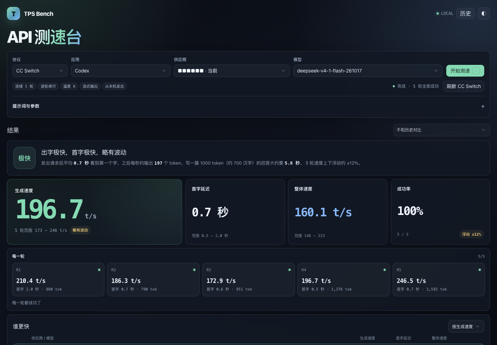

# TPS Bench — LLM API 测速与 TTFT / TPS Benchmark

本地的 LLM API 测速台，也是 [CC Switch](https://github.com/farion1231/cc-switch) 的配套面板：连续发起 5 轮流式请求，测量首字延迟（TTFT）、解码速度（decode TPS）和端到端吞吐（E2E TPS），用来对比不同供应商和模型的真实响应速度。

A local LLM API benchmark and companion to [CC Switch](https://github.com/farion1231/cc-switch): five streaming rounds measuring time-to-first-token (TTFT), decode TPS and end-to-end throughput, so you can compare providers and models on the same footing.

[在线介绍页](https://yhhd.github.io/tps-bench/) · [GitHub 仓库](https://github.com/YHHD/tps-bench)



[中文](#中文) · [English](#english)

---

## 中文

### 功能

- **CC Switch 配套**：直接读取 CC Switch 已保存的供应商、模型和凭据，默认即 `cc-switch` 协议
- 5 轮基准测试，逐轮记录 TTFT、decode TPS、E2E TPS、总耗时、输入/输出 token
- 统计 p50 / p95 / min / max、成功率、与基线的对比
- 供应商排行榜（谁更快）和趋势图
- 历史记录保存在浏览器 localStorage，可回看、删除
- 三种接入方式：CC Switch（默认）、Anthropic、OpenAI 兼容
- 明暗主题、流式输出、桌面与移动端自适应
- 零 npm 依赖，单页应用 + 本地 Node 代理

### 环境要求

| 项目 | 要求 |
| --- | --- |
| Node.js | >= 18 |
| sqlite3 | macOS 自带；Linux 需自行安装（仅 CC Switch 模式需要） |
| CC Switch | 推荐搭配；`cc-switch` 协议需要本机安装并运行 |

### 与 CC Switch 的关系

TPS Bench 是 [CC Switch](https://github.com/farion1231/cc-switch) 的配套测速面板。CC Switch 负责保存和切换 Claude Code / Codex 的供应商配置；TPS Bench 不重复维护这些配置，而是直接读取 CC Switch 数据库里的供应商、Base URL、模型目录和凭据，把同一套配置拿来实测。

- **默认接入方式**就是 `cc-switch`：打开页面时，供应商和模型下拉框直接来自 CC Switch 的 Claude Code / Codex 配置。
- **只读**：代理只执行 `SELECT`，不会修改 CC Switch 的供应商、当前配置或数据库文件。
- **凭据不外泄**：Base URL 和 Key 只在本地代理进程内使用，不返回浏览器、不写日志。
- **需要 CC Switch 在本机运行**：默认本地路由为 `http://127.0.0.1:15721`（`CC_SWITCH_ORIGIN` 可改），数据库默认 `~/.cc-switch/cc-switch.db`（`CC_SWITCH_DB` 可改）。
- **不依赖 CC Switch 也能用**：切到 Anthropic 或 OpenAI 兼容协议，手动填写 Base URL 和 Key 即可。

### 快速开始

```bash
git clone https://github.com/YHHD/tps-bench.git
cd tps-bench
npm start
```

然后打开 <http://127.0.0.1:8787/>，在页面顶部选择协议并开始测试。无需 `npm install`。

### 协议说明

| 协议 | 请求路径 | 说明 |
| --- | --- | --- |
| `cc-switch` | 浏览器 → 本地代理 → CC Switch 本地路由 | 代理以只读方式打开 `~/.cc-switch/cc-switch.db`，读取供应商的 Base URL、模型目录和凭据；凭据只在代理进程内使用，不返回浏览器、不写日志 |
| `anthropic` | 浏览器 → 本地代理 → `ANTHROPIC_UPSTREAM` | Base URL 填 `https://api.anthropic.com` 时页面会自动改用本地代理，由代理转发 |
| `openai` | 浏览器直连你填写的 Base URL | 上游必须允许 CORS；API Key 只保存在浏览器中 |

CC Switch 模式下，只有同时具备 Base URL、已存 API Key 和模型目录的供应商可测；仅 OAuth 登录的供应商会显示为“不可测”。

### 环境变量

| 变量 | 默认值 | 说明 |
| --- | --- | --- |
| `PORT` | `8787` | 本地服务端口 |
| `HOST` | `127.0.0.1` | 监听地址 |
| `CC_SWITCH_ORIGIN` | `http://127.0.0.1:15721` | CC Switch 本地路由地址 |
| `CC_SWITCH_DB` | `~/.cc-switch/cc-switch.db` | CC Switch 数据库路径 |
| `ANTHROPIC_UPSTREAM` | `https://api.anthropic.com/v1/messages` | `anthropic` 协议的上游 |
| `TPS_BENCH_UA` | `tps-bench/1.0` | 请求使用的 User-Agent |

### macOS 开机自启（可选）

```bash
NODE_BIN=$(command -v node)
sed -e "s|__NODE__|$NODE_BIN|g" -e "s|__PROJECT_DIR__|$PWD|g" \
  deploy/com.tps-bench.proxy.plist.example \
  > ~/Library/LaunchAgents/com.tps-bench.proxy.plist
launchctl bootstrap gui/$(id -u) ~/Library/LaunchAgents/com.tps-bench.proxy.plist
```

停止并移除：

```bash
launchctl bootout gui/$(id -u) ~/Library/LaunchAgents/com.tps-bench.proxy.plist
rm ~/Library/LaunchAgents/com.tps-bench.proxy.plist
```

日志写入 `/tmp/tps-bench-proxy.log` 和 `/tmp/tps-bench-proxy.error.log`。

### 隐私与安全

- 代理默认只监听 `127.0.0.1`。不要改成 `0.0.0.0` 后暴露在不可信网络中。
- 没有遥测、统计或外部上报；页面只请求你配置的端点。
- 配置和历史记录保存在当前浏览器的 localStorage。
- CC Switch 数据库只读访问；凭据不离开本地代理进程。
- 基准测试会消耗真实 API 额度，请自行控制轮次和 token 上限。

### 项目结构

```
tps-bench/
├── tps-bench.html                      # 单页界面与应用逻辑
├── opencode-proxy.mjs                  # 本地代理 + 静态文件服务
├── basecoat.css                        # Tailwind CSS 构建产物
├── deploy/com.tps-bench.proxy.plist.example
├── package.json
└── LICENSE
```

### 许可

[MIT](LICENSE)。`basecoat.css` 是 Tailwind CSS v4.3.1 的构建产物（MIT）。

---

## English

### Features

- **Built for CC Switch**: reads the providers, models and credentials already stored in CC Switch; `cc-switch` is the default protocol
- Five benchmark rounds recording TTFT, decode TPS, E2E TPS, total time and token usage
- p50 / p95 / min / max, success rate and baseline comparison
- Provider leaderboard and per-run trend charts
- Run history stored in browser localStorage
- Three connection modes: CC Switch (default), Anthropic and OpenAI-compatible
- Light/dark themes, streaming output, responsive layout
- Zero npm dependencies: a single-page app plus a small local Node proxy

The UI is in Chinese (labels such as 协议 = protocol, 供应商 = provider, 模型 = model).

### Requirements

| Item | Requirement |
| --- | --- |
| Node.js | >= 18 |
| sqlite3 | Bundled with macOS; install separately on Linux (CC Switch mode only) |
| CC Switch | Recommended; required for the `cc-switch` mode and must be running locally |

### Relationship to CC Switch

TPS Bench is the benchmarking companion for [CC Switch](https://github.com/farion1231/cc-switch). CC Switch stores and switches provider configurations for Claude Code / Codex; TPS Bench does not keep a second copy — it reads the providers, base URLs, model catalogs and credentials already in CC Switch and benchmarks exactly those configurations.

- **`cc-switch` is the default mode**: on load, the provider and model dropdowns come straight from CC Switch's Claude Code / Codex entries.
- **Read-only**: the proxy only runs `SELECT` queries; it never changes CC Switch's providers, active configuration or database file.
- **Credentials stay local**: base URLs and keys are used only inside the local proxy process; they are never returned to the browser or written to logs.
- **CC Switch must be running locally**: the default router is `http://127.0.0.1:15721` (override with `CC_SWITCH_ORIGIN`); the database defaults to `~/.cc-switch/cc-switch.db` (override with `CC_SWITCH_DB`).
- **CC Switch is optional**: the Anthropic and OpenAI-compatible modes work with a manually entered base URL and key.

### Quick start

```bash
git clone https://github.com/YHHD/tps-bench.git
cd tps-bench
npm start
```

Open <http://127.0.0.1:8787/>, pick a protocol and run a benchmark. No `npm install` needed.

### Protocols

| Protocol | Path | Notes |
| --- | --- | --- |
| `cc-switch` | browser → local proxy → CC Switch router | The proxy opens `~/.cc-switch/cc-switch.db` read-only to read each provider's base URL, model catalog and credentials. Credentials stay in the proxy process and are never returned to the browser or logged |
| `anthropic` | browser → local proxy → `ANTHROPIC_UPSTREAM` | When the base URL is `https://api.anthropic.com`, the page switches to the local proxy automatically |
| `openai` | browser → your base URL directly | The upstream must allow CORS; the API key only lives in the browser |

In CC Switch mode, a provider is testable only when it has a base URL, a stored API key and a model catalog. OAuth-only providers are shown as unavailable.

### Environment variables

| Variable | Default | Purpose |
| --- | --- | --- |
| `PORT` | `8787` | Local server port |
| `HOST` | `127.0.0.1` | Bind address |
| `CC_SWITCH_ORIGIN` | `http://127.0.0.1:15721` | CC Switch local router |
| `CC_SWITCH_DB` | `~/.cc-switch/cc-switch.db` | CC Switch database path |
| `ANTHROPIC_UPSTREAM` | `https://api.anthropic.com/v1/messages` | Upstream for `anthropic` |
| `TPS_BENCH_UA` | `tps-bench/1.0` | User-Agent sent upstream |

### Optional: run at login on macOS

```bash
NODE_BIN=$(command -v node)
sed -e "s|__NODE__|$NODE_BIN|g" -e "s|__PROJECT_DIR__|$PWD|g" \
  deploy/com.tps-bench.proxy.plist.example \
  > ~/Library/LaunchAgents/com.tps-bench.proxy.plist
launchctl bootstrap gui/$(id -u) ~/Library/LaunchAgents/com.tps-bench.proxy.plist
```

Remove it with:

```bash
launchctl bootout gui/$(id -u) ~/Library/LaunchAgents/com.tps-bench.proxy.plist
rm ~/Library/LaunchAgents/com.tps-bench.proxy.plist
```

Logs go to `/tmp/tps-bench-proxy.log` and `/tmp/tps-bench-proxy.error.log`.

### Privacy and security

- The proxy binds to `127.0.0.1` by default. Do not switch it to `0.0.0.0` on an untrusted network.
- No telemetry or analytics. The page only talks to the endpoints you configure.
- Settings and history live in this browser's localStorage.
- The CC Switch database is opened read-only; credentials never leave the local proxy process.
- Benchmarks consume real API quota — set round counts and token limits accordingly.

### Project layout

```
tps-bench/
├── tps-bench.html                      # single-page UI and app logic
├── opencode-proxy.mjs                  # local proxy + static file server
├── basecoat.css                        # Tailwind CSS build
├── deploy/com.tps-bench.proxy.plist.example
├── package.json
└── LICENSE
```

### License

[MIT](LICENSE). `basecoat.css` is a Tailwind CSS v4.3.1 build (MIT).
